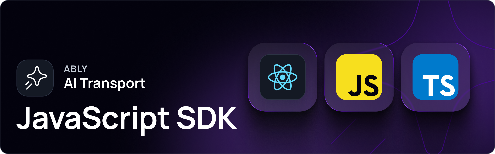

[](https://www.npmjs.com/package/@ably/ai-transport)
[](https://github.com/ably/ably-ai-transport-js/blob/main/LICENSE)

# Ably AI Transport JavaScript SDK

Ably AI Transport carries an AI agent's output over an Ably channel. Your agent pipes LLM output to clients over Ably messages, and every client on the channel receives each event as it is produced, in realtime. A client that reconnects picks up where it left off, and a conversation is available on all the user's devices.

Your application holds the channel through the Ably Pub/Sub SDK. On the agent, an adaptor publishes an LLM's events onto that channel. In the client, a decoder turns each message the channel delivers, live or from history, back into the same events. Your application merges the event stream into its own messages. The SDK includes an adaptor and a decoder for the Vercel AI SDK, the OpenAI Responses API and AG-UI, and you can define your own format with the `defineCodec` builder. Everything is built on [Ably](https://ably.com/) channels, so ordering, persistence, history, and presence come from the platform rather than from your application code.

> [!NOTE]
> This SDK is pre-release (`0.x`). The public API is still changing and minor versions can carry breaking changes. [CHANGELOG.md](./CHANGELOG.md) records what moved in each release, and the migration guides walk through each move: [0.9.0 to 0.10.0](./docs/migrations/0.9.0-to-0.10.0.md), [0.10.0 to 0.11.0](./docs/migrations/0.10.0-to-0.11.0.md) for the Ably Pub/Sub v3 packages, and [0.11.0 to 0.12.0](./docs/migrations/0.11.0-to-0.12.0.md) for the move from the transport to adaptors and decoders.

Find out more:

- [Ably AI Transport docs.](https://ably.com/docs/ai-transport)
- [Ably AI Transport examples.](https://ably.com/examples?product=ai_transport)

---

## Getting started

Everything you need to get started with Ably AI Transport:

- [Get started with the Core SDK.](https://ably.com/docs/ai-transport/getting-started/core-sdk)
- [Get started with Vercel AI SDK.](https://ably.com/docs/ai-transport/getting-started/vercel-ai-sdk)

---

## Supported platforms

Ably aims to support a wide range of platforms. If you experience any compatibility issues, open an issue in the repository or contact [Ably support](https://ably.com/support).

This SDK supports the following platforms:

| Platform      | Support                                                                                   |
| ------------- | ----------------------------------------------------------------------------------------- |
| Node.js       | Version 22 or newer.                                                                      |
| Browsers      | All major desktop and mobile browsers, including Chrome, Firefox, Edge, and Safari.       |
| TypeScript    | Fully supported, the library is written in TypeScript and ships its own type definitions. |
| Vercel AI SDK | Versions 6 and 7, through `@ably/ai-transport/vercel`.                                    |
| OpenAI        | The Responses API, through `@ably/ai-transport/openai`.                                   |
| AG-UI         | Version 1 events, through `@ably/ai-transport/ag-ui`.                                     |

The Ably Pub/Sub SDK version 3 is required in every case: `@ably/pubsub-server` or `@ably/pubsub-device` to build the client. `ai`, `openai` and `@ag-ui/core` are optional peer dependencies, each needed only by the entry point that uses it.

---

## Installation

The AI Transport SDK is available as an [npm module](https://www.npmjs.com/package/@ably/ai-transport). It is built on top of the Ably Pub/Sub SDK and uses that to establish a connection with Ably, so install it alongside the Pub/Sub package for where your code runs: `@ably/pubsub-server` for an agent on infrastructure you operate, `@ably/pubsub-device` for a client on an end user's device.

```sh
npm install @ably/ai-transport @ably/pubsub-server   # in your agent
npm install @ably/ai-transport @ably/pubsub-device   # in your client
```

For a Vercel AI SDK project, add `ai` as well:

```sh
npm install @ably/ai-transport @ably/pubsub-server ai
```

AI Transport streams a response by appending tokens to a single Ably message, which requires the `mutableMessages` channel rule on the namespace your conversations live in. This is a one-time setup per Ably app: without it the first append fails with error `93002` and no tokens reach the client. See [configure channel rules](https://ably.com/docs/ai-transport/getting-started/channel-rules).

---

## Usage

The following code streams a model response from a Next.js route handler onto an Ably channel, then reads it back on a client. The SDK carries the events; your application decides what to do with them and owns the conversation. `demo/minimal` in this repository is the same app in full, with the authentication endpoint.

### Agent

```typescript
import { streamText, convertToModelMessages, toUIMessageStream, type UIMessage } from 'ai';
import { openai } from '@ai-sdk/openai';
import { createRealtimeClient, ErrorInfo } from '@ably/pubsub-server';
import { ErrorCode } from '@ably/ai-transport';
import { vercelAdaptor } from '@ably/ai-transport/vercel';

const pubsubClient = createRealtimeClient({ key: process.env.ABLY_API_KEY });

export async function POST(req: Request) {
  // The client has already published its message on the channel; the POST
  // wakes the agent with that one message. Record it in your store and
  // hydrate the conversation so far from there, never from the request body.
  // Tokens reach every client over the channel, so the response body carries
  // nothing the client reads.
  const { channelName, message } = (await req.json()) as { channelName: string; message: UIMessage };
  await recordMessage(channelName, message);
  const messages: UIMessage[] = await loadConversation(channelName);

  // You get the channel from your own client; the adaptor publishes on it.
  const adaptor = vercelAdaptor(pubsubClient.channels.get(channelName));

  const result = streamText({
    model: openai('gpt-4o-mini'),
    messages: await convertToModelMessages(messages),
    abortSignal: req.signal,
  });

  // One Ably operation per chunk: a text or tool-input stream's deltas share
  // one message that grows by appends, and every other chunk, the stream's
  // start and end included, is a publish. The pipe resolves with the serial of
  // its last publish, and rejects with an ErrorInfo whose code says whether
  // the signal cancelled it (OperationCancelled) or it failed (PipeFailed).
  // The headers ride on every message of the reply, so the client can tell
  // which prompt it answers. The AI SDK puts a message id on the reply's
  // `start` chunk only when it has the conversation and an id generator;
  // without one, every reply reaches the client with the same empty id.
  const headers = { requestId: message.id };
  try {
    await adaptor.pipe(
      toUIMessageStream({
        stream: result.fullStream,
        originalMessages: messages,
        generateMessageId: () => crypto.randomUUID(),
      }),
      { signal: req.signal, headers },
    );
    return new Response(null, { status: 204 });
  } catch (error) {
    // The pipe published no `finish`, so tell the clients the reply has
    // ended. Best effort: the publish may fail for the same reason the pipe did.
    try {
      await adaptor.send({ type: 'abort' }, { headers });
    } catch (sendError) {
      console.error('abort publish failed', sendError);
    }
    const cancelled = error instanceof ErrorInfo && error.code === ErrorCode.OperationCancelled;
    return new Response(null, { status: cancelled ? 204 : 500 });
  }
}
```

`pipe` runs unattended. `pipeEach` writes the same stream and hands each event back once it is written, with the serial of the message it landed on, so the agent can act inside the loop. The adaptor reads the next event only when the loop body has finished.

```typescript
for await (const { event, serial } of adaptor.pipeEach(stream, { signal })) {
  if (event.type === 'finish') await db.saveReplySerial(serial);
  heartbeat();
}
```

Like `pipe`, `pipeEach` flushes the stream's appends and repairs any that failed before it settles, however the loop ends: the source ending, the pipe failing, the signal, or a `break`, a `return` or a throw in the loop body. A stop writes nothing more and ends no stream, so a client sees a stream that was cut off stay open, with its full text. Leaving the loop waits for that repair. Stopping early does not stop the source either: a `ReadableStream` is released, not cancelled, so abort the model call with the same signal if it should stop too.

### Client

The client subscribes to the channel through the Ably Pub/Sub SDK and passes every message to a decoder. The decoder gives each message back as deliveries holding the decoded event, and the application merges the events into whatever it renders from.

```typescript
import { readUIMessageStream, type UIMessage, type UIMessageChunk } from 'ai';
import { createClient } from '@ably/pubsub-device';
import { vercelAdaptor, vercelDecoder } from '@ably/ai-transport/vercel';

const pubsubClient = createClient({ authUrl: '/api/auth/token' });
const channelName = 'conversations:abc';
const channel = pubsubClient.channels.get(channelName);

// One decoder per channel, for live delivery and history together. Every
// message comes back as a delivery: `event` is undefined for a message that
// is not the codec's, such as your application's own messages on the channel.
// Nothing here assembles a message list, that is yours. Here the AI SDK's own
// reducer merges one reply: `start` opens a stream, and every chunk until
// `finish` or `abort` goes into it. The agent publishes `abort` when its pipe
// ends early, and then no `finish` comes.
const decoder = vercelDecoder();
let reply: ReadableStreamDefaultController<UIMessageChunk> | undefined;
decoder.onEvent(({ event }) => {
  if (event === undefined || event.type === 'user-message') return;
  if (event.type === 'start') {
    const stream = new ReadableStream<UIMessageChunk>({ start: (c) => (reply = c) });
    void merge(stream);
  }
  reply?.enqueue(event);
  if (event.type === 'finish' || event.type === 'abort') reply?.close();
});
decoder.onError((error) => console.error(error));
await channel.subscribe(decoder.receive);

async function merge(stream: ReadableStream<UIMessageChunk>) {
  for await (const message of readUIMessageStream({ stream })) render(message);
}

// Publish the turn on the channel, then wake the agent with the same message.
// Your own message comes back as an ordinary delivery under the serial send
// returns; the agent hydrates the rest of the conversation from its store.
const message: UIMessage = { id: 'm1', role: 'user', parts: [{ type: 'text', text: "what's the weather?" }] };
const { serial } = await vercelAdaptor(channel).send(
  { type: 'user-message', message },
  { headers: { requestId: message.id } },
);
await fetch('/api/chat', {
  method: 'POST',
  headers: { 'content-type': 'application/json' },
  body: JSON.stringify({ channelName, message }),
});
```

`channel.unsubscribe(decoder.receive)` stops the subscription, since `receive` is bound to the decoder.

### Catching up from a stored serial

A client can join what its database holds with the channel by rewinding the channel to the last serial it stored, the one a publish ack returned. Pass the serial as the channel's `rewind` param when you get the channel. When the channel attaches, the platform delivers every message after that serial through your subscription, then live messages, in channel order. The serial's own message is not replayed. A message that was appended to arrives first as one update with its full content, which the decoder hands on as one delta with all the text so far, and the appends after it as deltas.

```typescript
const channel = pubsubClient.channels.get(
  channelName,
  stored.serial === undefined ? undefined : { params: { rewind: stored.serial } },
);
const decoder = vercelDecoder();
decoder.onEvent(({ event }) => {
  /* as in the client example */
});
await channel.subscribe(decoder.receive);
```

Rewind applies only when the channel attaches, so set it on the first `channels.get` for the channel, before the first subscribe. For a channel that is already attached, `channels.get` with a different `rewind` throws, and `channel.setOptions` is the call that changes it. It delivers at most 1,000 messages after the serial; appends to one message count as that message. One decoder sees every message in order, so nothing is decoded twice and nothing needs merging. `demo/minimal` stores the serial of each prompt and of each finished reply, and rewinds to the latest when the page loads.

The channel keeps its `rewind` param. After the channel goes DETACHED or FAILED it cannot resume, so its next attach would rewind from the old serial again and replay messages your application has already applied. An attach or update with `resumed: false` means the channel skipped messages. In either case, read your store again and rewind from the serial it returns: detach the channel, set the newer serial with `channel.setOptions({ params: { rewind } })`, and subscribe a new decoder. `demo/minimal` does this from its channel state listener, and mounts a fresh chat on the newer serial.

### Tagging a turn

`send`, `pipe` and `pipeEach` take `headers`, a flat map of string, number, boolean or null values that the adaptor includes in `extras.headers` on every message the call publishes. An adaptor can carry default headers as well, `vercelAdaptor(channel, { headers })`. A call's headers win over the defaults, and any headers the codec writes win over both.

You can read the headers from the raw Ably message in a delivery, `message.extras.headers`, or in the `headers` field passed to `decode` in the codec builder.

### AG-UI

`agUiAdaptor` and `agUiDecoder` carry [AG-UI](https://docs.ag-ui.com) events. An agent pipes its event stream, and every client decodes the same events and can merge them with AG-UI's own reducer, such as an `AbstractAgent` from `@ag-ui/client`. A client can start a run by sending the codec's own `run-input` event, which carries a `RunAgentInput`.

```typescript
import { agUiAdaptor, agUiDecoder } from '@ably/ai-transport/ag-ui';

const adaptor = agUiAdaptor(channel);

// Client: send only the messages this run adds.
await adaptor.send({ type: 'run-input', input: { threadId, runId, messages: [userMessage], tools, context } });

// Agent: the runId header goes on every message of the run.
await adaptor.pipe(events, { headers: { runId } });

// Client: decode what the channel delivers.
const decoder = agUiDecoder();
await channel.subscribe(decoder.receive);
```

The codec does not support `MESSAGES_SNAPSHOT`, and some events change on the wire:

- The codec does not publish `MESSAGES_SNAPSHOT`, and an inbound one does not decode to an event. A snapshot holds the whole conversation and grows past the Ably message size limit. Your application can load the conversation from its own store, and join the channel at a run boundary.
- `RUN_STARTED` travels with `input.messages` empty, for the same reason. Its other input fields travel as they are.
- `TEXT_MESSAGE_CONTENT`, `TOOL_CALL_ARGS` and `REASONING_MESSAGE_CONTENT` append to one message per stream. History and a client that joins late read one delta event per stream, with the text joined. That event carries the `timestamp` and `metadata` of the last delta only.
- The codec strips `rawEvent` from every event. The field carries the provider event that the AG-UI event was translated from, so it repeats the event's content. AG-UI's reducer does not read it.
- Every `*_CHUNK` event is its own message. A chunk stream does not have an end event, so the adaptor cannot hold the next message back until Ably has acknowledged the stream's appends. An agent that wants one message per stream in history can emit the START, CONTENT and END events.
- Every other event travels whole. The codec does not check sizes, so a large `STATE_SNAPSHOT`, `ACTIVITY_SNAPSHOT`, `TOOL_CALL_RESULT` or `RUN_FINISHED` fails its publish, and `pipe` rejects.

AG-UI's reducer rejects a stream that does not start with `RUN_STARTED`, and its state deltas patch the state the client already holds. So a client must join at a run boundary, with its messages and state loaded from your store. Your agent should pipe one run at a time to a channel.

### Your own format

`defineCodec` builds a codec from one row per event type, and `createAgentAdaptor` and `createDecoder` wrap it the way the provider factories wrap theirs.

```typescript
import { createAgentAdaptor, createDecoder, defineCodec } from '@ably/ai-transport';

const codec = defineCodec({
  id: 'my-format',
  typeOf: (e: MyEvent) => e.type,
  events: {
    /* one { encode, decode } row per event type */
  },
});
const adaptor = createAgentAdaptor(channel, codec);
const decoder = createDecoder(codec);
```

Every message a codec encodes carries the codec's `name`, `ai` unless you pass `name` to `defineCodec`, and its `id`, and a decoder skips a message with another name or another codec's id. Two formats can share a channel when their ids differ. A hand-written codec must write both itself.

### React

The SDK has no React entry point. Mount `<PubSubClientProvider>` and `<ChannelProvider>` from `@ably/pubsub-device/react`, passing the `rewind` param in the provider's `options` when you catch up from a stored serial, then get the channel from the client, subscribe a decoder in an effect and attach the channel, as `demo/minimal/src/app/page.tsx` and `chat.tsx` do. `<ChannelProvider>` turns off ably-pubsub-js's attach on subscribe, so the application attaches the channel itself with `channel.attach()`. Subscribe first, so the messages a rewind delivers on attach reach the decoder. Create the decoder inside the effect, one per run: an effect can run again, under Fast Refresh for example, and a decoder kept across runs drops text it has already seen.

### useChat

`@ably/ai-transport/vercel` also ships a `ChatTransport` for the AI SDK's `useChat`. It posts each turn to your backend as `useChat` describes it, and reads the reply off the conversation's channel rather than the response body. A reply therefore outlives the request: a tab that reloads, or opens mid-reply, rejoins it. The [Vercel AI SDK UI guide](https://ably.com/docs/ai-transport/frameworks/vercel-ai-sdk-ui) covers it in full.

```tsx
import { useChat } from '@ai-sdk/react';
import { usePubSubClient } from '@ably/pubsub-device/react';
import { createChatTransport } from '@ably/ai-transport/vercel';
import { useEffect, useMemo } from 'react';

// Inside a <PubSubClientProvider> from @ably/pubsub-device/react.
function Chat({ channelName }: { channelName: string }) {
  const channel = usePubSubClient().channels.get(channelName);
  // One transport per conversation, kept across renders.
  const transport = useMemo(() => createChatTransport({ channel }), [channel]);
  // useChat never closes a transport, so close it with the conversation.
  useEffect(() => () => transport.close(), [transport]);

  const { messages, status, stop } = useChat({ id: channelName, transport, resume: true });
  // stop() ends the reply in this tab. Tell the agent from the Stop button,
  // however yours listens: here, a cancel it is subscribed to on the channel.
  const onStopClick = () => {
    void channel.publish({ name: 'cancel', data: {} });
    void stop();
  };
  // Render the messages as with any useChat transport.
  return (
    <>
      <p>{messages.length} messages</p>
      {(status === 'submitted' || status === 'streaming') && <button onClick={onStopClick}>Stop</button>}
    </>
  );
}
```

The transport subscribes to the channel on its first call and attaches it if nothing has, then reads history back to the running turn from where the channel attached. So leave the first attach to the transport, and give it a channel with no `rewind` param, since the messages a rewind replays are in that history too. `close()` detaches the channel only when the transport's read attached it.

`POST /api/chat` receives `{ chatId, trigger, messageId, messages }`, plus any `body` in the request options of the call that sends the turn: `sendMessage`, `regenerate`, or `addToolOutput` and `addToolApprovalResponse` when `sendAutomaticallyWhen` sends it. The AI SDK's own transport sends `id` where this one sends `chatId`. The transport reads only the response's status, and on a failure the start of its body, for the error. The reply goes over the channel, so the backend can answer at once and run the agent past the response, for example in Next.js `after()`. A reply then goes on when the tab that asked for it reloads or closes, and stops only when the agent is told to: `useChat` aborts its reply on unmount too, so send the cancel from the Stop button, not from cleanup code. Turns on a channel run one at a time: the transport cannot tell one turn's chunks from another's, so the backend starts a turn only once the previous one has published its end.

The agent pipes `toUIMessageStream` onto the chat's channel with `vercelAdaptor`, as in the agent example above. That opens each turn with a `start` chunk and ends it with `finish`, or with `abort` when the model call is aborted, as when the agent hears the cancel the Stop button publishes. When the model fails it writes `error`, sometimes followed by `finish`, and the reply ends at the `error`. On any other exit the agent publishes `abort` or `error` itself, and an agent that fails before it streams anything publishes `error`. If the agent dies before it can, whatever runs it, such as a workflow, publishes `error` for it, which ends the reply even if the agent died before its `start`. Without a terminal chunk the turn looks like it is still running, and every tab showing it stays `streaming` until Stop. A turn has one `start` and one end: when merging several UI message streams into one turn, pass `sendStart: false` to every stream but the first and `sendFinish: false` to every stream but the last. A reply carries only what is written from `start` to the end, so write any data part that updates after the model finishes before the turn's `finish`: merge the model's stream with `sendFinish: false` and write `finish` last. Pass `logger` to see what the transport logs, such as a turn whose request failed.

Some of what the transport relies on arrived in patch releases of `ai` and `@ai-sdk/react`; `createChatTransport`'s documentation lists them.

---

## Contribute

Read the [CONTRIBUTING.md](./CONTRIBUTING.md) guidelines to contribute to Ably, or [open an issue](https://github.com/ably/ably-ai-transport-js/issues) to share feedback or request a feature.

---

## Releases

The [CHANGELOG.md](./CHANGELOG.md) contains details of the latest releases for this SDK. You can also view all Ably releases on [changelog.ably.com](https://changelog.ably.com).

---

## Support, feedback, and troubleshooting

For help or technical support, visit Ably's [support page](https://ably.com/support) or [GitHub Issues](https://github.com/ably/ably-ai-transport-js/issues) for community-reported bugs and discussions.

[Troubleshooting AI Transport](https://ably.com/docs/ai-transport/troubleshooting) covers the failures teams hit most often, with the error codes to match.
